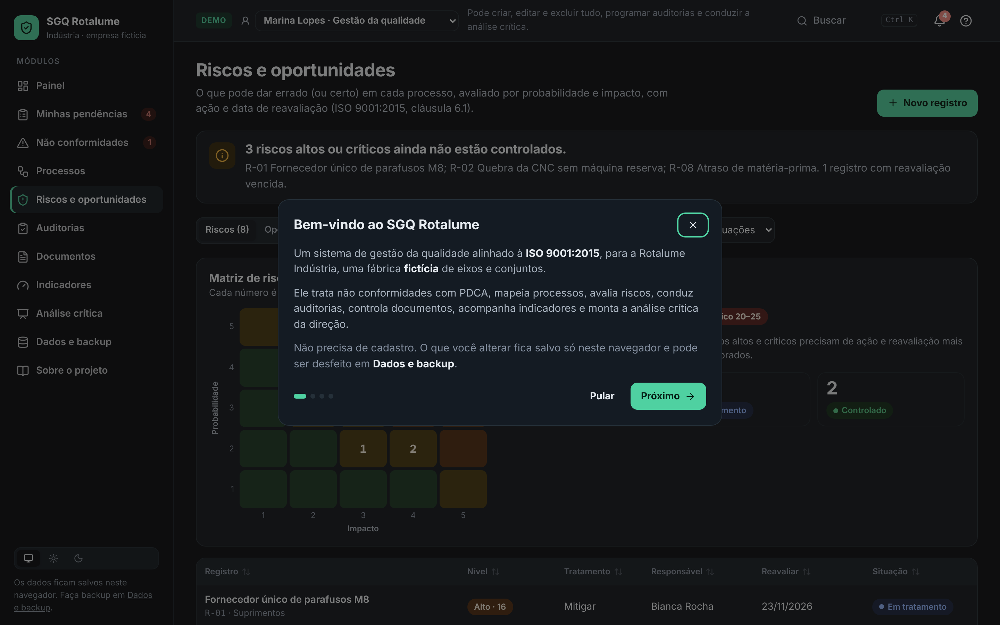
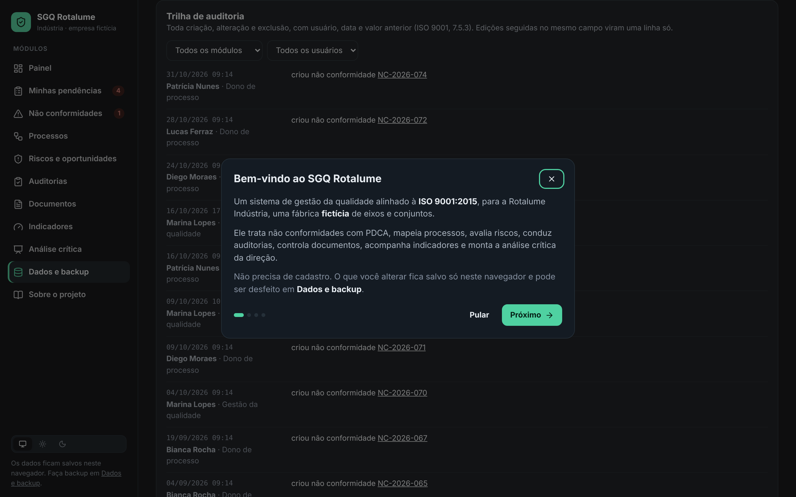
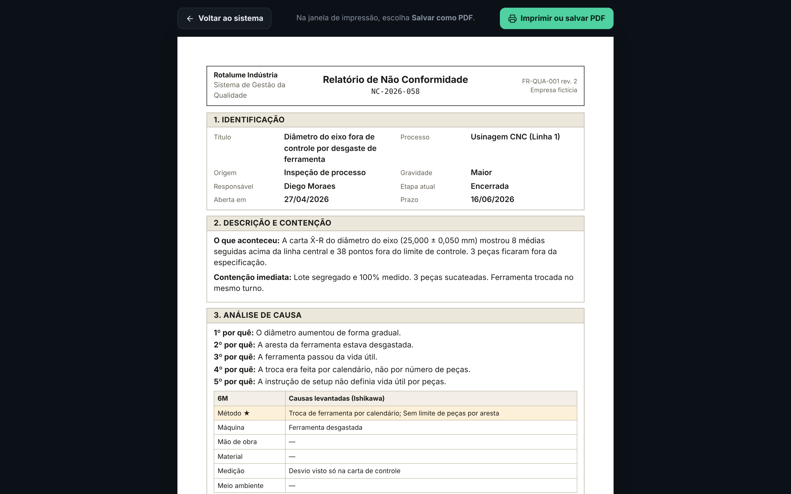

# SGQ Rotalume · Sistema de gestão da qualidade

[](https://github.com/Oberon-23/SGQ-Rotalume/actions/workflows/ci.yml)

Sistema web de gestão da qualidade (SGQ) aderente à ISO 9001:2015, construído para a **Rotalume Indústria**, uma fábrica de componentes metálicos **fictícia**. Cobre não conformidades com PDCA, mapa de processos com SIPOC, riscos e oportunidades, auditorias internas, documentos, indicadores e análise crítica pela direção, com perfis de acesso, trilha de auditoria e relatórios em PDF.

> Projeto de portfólio de **Breno Silva**, focado em engenharia de processos e qualidade. Os dados são fictícios.


## O problema

Pequenas e médias indústrias costumam controlar a qualidade em planilhas: uma para NCs, outra para documentos, outra para indicadores. Os prazos se perdem, ninguém sabe quem alterou o quê, e na véspera da auditoria de certificação alguém junta tudo à mão.

Os painéis anteriores do portfólio **mostram** números. Este projeto **opera** o processo: registra o problema, obriga a análise de causa, cobra o plano de ação, só encerra depois da verificação de eficácia e guarda o histórico de tudo.

## Experimente em 1 minuto

1. Abra o sistema. Não precisa de cadastro: ele abre no **modo demonstração**, como a gestora da qualidade, com uma apresentação de 4 passos.
2. Em **Não conformidades**, abra a NC-2026-069 e complete a análise de causa. Repare que o sistema não deixa avançar sem 3 porquês, causa raiz e categoria 6M.
3. No topo da página, troque para **Diego Moraes (dono de processo)**: ele edita só o que é dele e não exclui nada.
4. Gere a **RNC em PDF** de qualquer não conformidade e veja o **histórico de alterações** no fim da página.

## Módulos

| Módulo | O que faz | ISO 9001:2015 |
|---|---|---|
| **Painel** | Resumo do dia: NCs vencidas, ações atrasadas, auditorias próximas, documentos a revisar, indicadores fora da meta | 9.1 |
| **Não conformidades** | Fluxo em 5 etapas: registro e contenção → análise de causa (5 Porquês + Ishikawa 6M) → plano de ação (5W2H) → verificação de eficácia → encerramento | 10.2 |
| **Processos** | Mapa de processos (gestão, principais, apoio) com SIPOC, dono, objetivo e vínculos | 4.4 |
| **Riscos e oportunidades** | Matriz 5×5 de probabilidade × impacto, tratamento, responsável e data de reavaliação | 6.1 |
| **Auditorias internas** | Programa por processo e checklist por requisito (C / NC / OBS / OM). Uma constatação de NC abre a não conformidade já vinculada | 9.2 |
| **Documentos** | Lista mestra com revisões, histórico de versões, status e prazo de revisão periódica | 7.5 |
| **Indicadores** | KPIs com meta e sentido (maior ou menor é melhor), série mensal e alertas fora da meta | 9.1 |
| **Análise crítica** | Entradas da 9.3.2 montadas automaticamente a partir dos módulos, decisões com responsável e prazo, ata em PDF | 9.3 |
| **Dados e backup** | Trilha de auditoria completa, backup .json, restauração e exportação CSV | 7.5.3 |


## O que faz parecer um sistema, e não um protótipo



### Feito para o dia a dia

- **Minhas pendências**: cada pessoa vê o que está com ela (NCs, ações do 5W2H, documentos a revisar, auditorias, indicadores a lançar, riscos a reavaliar, decisões da direção), do prazo mais curto ao mais longo. A gestora pode ver a fila de qualquer pessoa.
- **Notificações**: o sino mostra prazos vencidos e dos próximos 7 dias, com contador do que ainda não foi visto.
- **Busca geral** (`Ctrl + K` ou `/`): códigos, assuntos e pessoas em todos os módulos, sem diferenciar acentos, com navegação pelo teclado.
- **Listas**: ordenação por coluna, paginação e, nas não conformidades, ações em lote (reatribuir responsável, alterar prazo, exportar a seleção), respeitando o perfil.
- **Apresentação guiada** na primeira visita, reabrível pelo botão **?**.

### Perfis de acesso

| Perfil | Pode |
|---|---|
| Gestão da qualidade | Tudo: criar, editar, excluir, programar auditorias, conduzir a análise crítica, restaurar backups |
| Dono de processo | Registrar NCs e riscos; editar os próprios processos, NCs, documentos, indicadores e riscos. Não exclui |
| Auditor interno | Programar e conduzir auditorias, exceto em processos dos quais é dono (independência, 9.2.2) |
| Leitor | Ver tudo e exportar planilhas |

No modo demonstração, o perfil é trocado no topo da página. Em produção, as mesmas regras viram políticas no banco de dados (veja [docs/arquitetura.md](docs/arquitetura.md)).

### Trilha de auditoria

Toda criação, alteração e exclusão fica registrada com usuário, perfil, data e hora, campo, valor anterior e valor novo. Cada registro mostra o próprio histórico, e a página **Dados e backup** tem a trilha completa com filtros e exportação para CSV. Digitação seguida no mesmo campo vira uma linha só, para o histórico continuar legível.



### Relatórios para imprimir e assinar

- **RNC** (relatório de não conformidade): identificação, descrição, contenção, 5 Porquês, Ishikawa, 5W2H, eficácia e assinaturas.
- **Relatório de auditoria interna**: escopo, resumo, checklist com evidências e assinaturas.
- **Ata de análise crítica**: entradas, decisões, conclusão e assinaturas.

São gerados pelo próprio navegador ("Salvar como PDF"), em A4, sem biblioteca extra.



### Regras que o sistema impõe

- Uma NC só avança de etapa quando a anterior está completa, e só encerra com eficácia confirmada e evidência.
- Se a verificação concluir que a ação **não foi eficaz**, a NC volta para a análise de causa (novo ciclo PDCA).
- Toda constatação de NC em auditoria precisa de tratamento, com vínculo entre o item do checklist e a NC.
- O auditor não pode ser o dono do processo auditado.
- Um processo com registros ligados não pode ser excluído.
- A análise crítica só é concluída com participantes, ao menos uma decisão e conclusão.

### CRUD completo

Todos os módulos permitem criar, editar e excluir (com confirmação). NCs podem voltar de etapa e ser reabertas. Checklists aceitam requisitos extras. Indicadores aceitam correção e exclusão de resultados mensais.

## Arquitetura

As telas nunca gravam direto no armazenamento. Toda escrita passa pelo store, que calcula o que mudou, registra na trilha e entrega para a fonte de dados. Hoje a fonte é o navegador (modo demonstração). Para um banco real, troca-se só a fonte. Detalhes, esquema SQL e políticas de acesso em **[docs/arquitetura.md](docs/arquitetura.md)**.

```
src/
  data/
    types.ts       modelo de dados
    utils.ts       regras do PDCA, metas, vencimentos, nível de risco
    access.ts      perfis e permissões
    changes.ts     detecção de alterações e trilha de auditoria
    review.ts      entradas da análise crítica (9.3.2)
    pending.ts     pendências e notificações de cada pessoa
    source.ts      fonte de dados trocável + migração de versões
    store.tsx      único ponto de escrita
    seed.ts        dados de exemplo (datas relativas a hoje)
    rules.test.ts  testes das regras de negócio
  components/      layout, histórico, perfil de demonstração, gráficos
  pages/           um arquivo por módulo + relatórios para impressão
```

## Dados

- Os exemplos são gerados em relação à data de hoje, então prazos e vencimentos sempre fazem sentido: 13 processos, 12 NCs, 11 riscos e oportunidades, 6 auditorias, 12 documentos, 8 indicadores com 12 meses de histórico e 1 análise crítica anterior.
- Tudo fica no `localStorage` do navegador. Dados de versões anteriores são migrados automaticamente, sem perder o que foi cadastrado.
- Em **Dados e backup**: backup completo em .json, restauração, CSV de NCs, indicadores e trilha (abre direto no Excel ou no Power BI) e restauração dos dados de exemplo.

## Roadmap para produto

| Etapa | Itens |
|---|---|
| Feito | 7 módulos ISO, CRUD completo, perfis, trilha de auditoria, relatórios PDF, pendências por pessoa, notificações, busca geral, listas com lote, backup, testes e CI |
| Próximo | Banco Postgres (Supabase), login, empresas separadas, regras de acesso no banco |
| Depois | Anexos de evidência, e-mails de prazo (a regra já existe em `pending.ts`), aprovação de documentos, fornecedores (IQF), treinamentos, calibração |
| Produto | Adequação à LGPD, planos de assinatura, importação de planilhas existentes |

## Stack e qualidade

- React 19 + TypeScript + Vite, React Router, lucide-react
- Gráficos e matriz de risco em SVG/CSS próprios, sem biblioteca
- Tema claro (creme), escuro e automático
- **Vitest**: testes das regras de negócio (PDCA, matriz de risco, trilha, permissões, migração, análise crítica, pendências, busca)
- **GitHub Actions**: lint, testes e build a cada envio
- Deploy na Vercel

## Como rodar

```bash
npm install
npm run dev      # desenvolvimento
npm test         # testes
npm run build    # build de produção em dist/
```

## Outros projetos

- [Service Desk Analytics](https://github.com/Oberon-23/service-desk-analytics-mvp)
- [Painel de Qualidade Rotalume](https://painel-qualidade-rotalume.vercel.app)
- [Portfólio](https://portfolio-two-blond-10.vercel.app)
