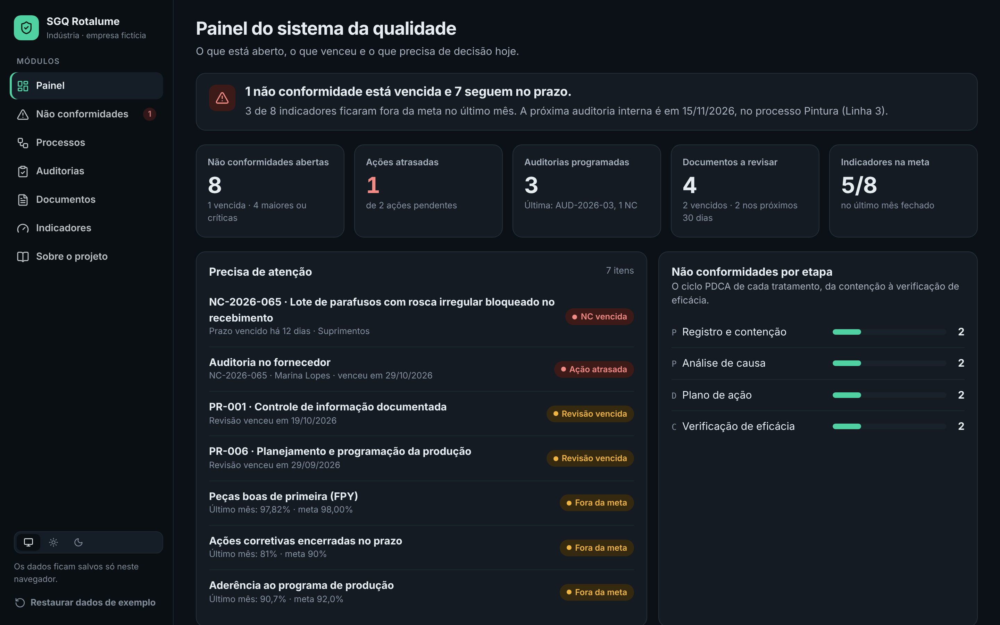
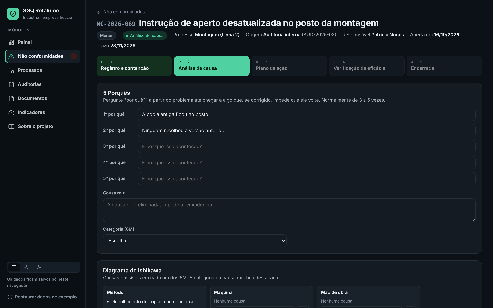

# SGQ Rotalume · Sistema de gestão da qualidade

Sistema web de gestão da qualidade (SGQ) para a **Rotalume Indústria**, uma fábrica de componentes metálicos **fictícia**. O sistema trata não conformidades com PDCA, mapeia processos com SIPOC, conduz auditorias internas no checklist da ISO 9001:2015, controla documentos e acompanha indicadores contra meta.

> Projeto de portfólio de **Breno Silva**, focado em engenharia de processos e qualidade. Os dados são fictícios.



## Por que este projeto

Os painéis anteriores (Service Desk, Qualidade) **mostram** números. Este projeto **opera** o processo: registra o problema, obriga a análise de causa, cobra o plano de ação e só encerra depois da verificação de eficácia. Em uma empresa real, esse é o trabalho do analista da qualidade e de processos, e o sistema impõe a disciplina do PDCA em vez de depender da memória de cada um.

## Módulos

| Módulo | O que faz | ISO 9001:2015 |
|---|---|---|
| **Painel** | Resumo do dia: NCs vencidas, ações atrasadas, auditorias próximas, documentos a revisar, indicadores fora da meta | 9.1 |
| **Não conformidades** | Fluxo em 5 etapas: registro e contenção → análise de causa (5 Porquês + Ishikawa 6M) → plano de ação (5W2H) → verificação de eficácia → encerramento | 10.2 |
| **Processos** | Mapa de processos (gestão, principais, apoio) com SIPOC, dono, objetivo e vínculos com NCs, documentos e indicadores | 4.4 |
| **Auditorias internas** | Programa de auditorias por processo e checklist com 10 requisitos (C / NC / OBS / OM). Uma constatação de NC abre a não conformidade já vinculada | 9.2 |
| **Documentos** | Lista mestra com revisões, histórico de versões, status e prazo de revisão periódica | 7.5 |
| **Indicadores** | KPIs com meta e sentido (maior/menor é melhor), série mensal, lançamento de resultado e alertas fora da meta | 9.1 |



## Regras que o sistema impõe

- Uma NC só avança de etapa quando a anterior está completa. Por exemplo, a análise exige causa raiz e pelo menos três porquês, e a verificação exige todas as ações concluídas.
- Se a verificação concluir que a ação **não foi eficaz**, a NC volta para a análise de causa (novo ciclo PDCA).
- Ações e NCs vencidas aparecem em vermelho no painel e na navegação.
- Toda constatação de NC em auditoria precisa de tratamento. O item do checklist mostra o vínculo com a NC aberta.
- Ao publicar uma nova revisão de documento, o prazo de revisão é renovado e o histórico é preservado.

## Dados

- Os dados de exemplo são gerados em relação à data de hoje, então prazos e vencimentos sempre fazem sentido: 13 processos, 12 NCs, 6 auditorias, 12 documentos e 8 indicadores com 12 meses de histórico.
- Tudo que você cria ou altera fica salvo no **localStorage** do navegador. Não há servidor nem login.
- O botão **Restaurar dados de exemplo** volta ao estado inicial.

## Stack

- React 19 + TypeScript + Vite
- React Router (rotas por módulo, deploy na Vercel com rewrites)
- lucide-react (ícones)
- Gráficos em SVG próprio, sem biblioteca
- Tema claro (creme) / escuro / automático, no mesmo visual dos painéis Rotalume

## Como rodar

```bash
npm install
npm run dev      # desenvolvimento
npm run build    # build de produção em dist/
```

## Estrutura

```
src/
  data/        tipos, dados de exemplo, regras (bloqueios do PDCA, vencimentos) e store com localStorage
  components/  layout, modal, gráficos e elementos de interface
  pages/       um arquivo por módulo (lista + detalhe)
```

## Outros projetos

- [Service Desk Analytics](https://github.com/Oberon-23/service-desk-analytics-mvp)
- [Painel de Qualidade Rotalume](https://painel-qualidade-rotalume.vercel.app)
- [Portfólio](https://portfolio-two-blond-10.vercel.app)
