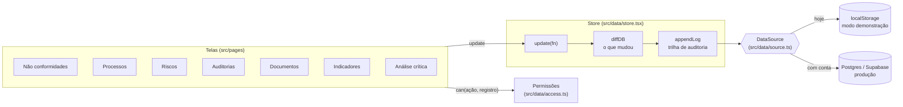

# Arquitetura do SGQ Rotalume

Este documento explica como o sistema está organizado e o caminho para levá-lo do modo demonstração (dados no navegador) a um produto com banco de dados, login e várias empresas.

## Visão geral

### Camadas

| Camada | Arquivo | Responsabilidade |
|---|---|---|
| Tipos | `src/data/types.ts` | Modelo de dados: processos, NCs, auditorias, documentos, indicadores, riscos, análises críticas e trilha |
| Regras | `src/data/utils.ts` | Bloqueios do PDCA, vencimentos, metas, nível de risco |
| Permissões | `src/data/access.ts` | O que cada perfil pode criar, editar e excluir |
| Alterações | `src/data/changes.ts` | Compara o banco antes e depois, descreve os campos e registra a trilha |
| Análise crítica | `src/data/review.ts` | Monta as entradas da cláusula 9.3.2 a partir dos módulos |
| Fonte de dados | `src/data/source.ts` | Onde os dados ficam. Hoje: navegador. Interface pronta para backend |
| Store | `src/data/store.tsx` | Único ponto de escrita: aplica, registra, persiste |

### Por que toda escrita passa pelo store

As telas nunca gravam direto no armazenamento. Elas chamam `update(fn)`, e o store:

1. aplica a mudança numa cópia do banco;
2. calcula com `diffDB` quais registros foram criados, alterados ou excluídos;
3. acrescenta essas mudanças à trilha de auditoria, com usuário, data e valor anterior;
4. entrega o novo estado e a lista de mudanças para `source.persist`.

Isso garante que **nenhuma alteração escapa da trilha** e que trocar o armazenamento não exige mexer nas telas.

## Banco de dados (Supabase)

A fonte remota está em `src/data/remote.ts` (`RemoteSource`) e a conexão (login, perfis, tempo real, Storage) em `src/data/cloud.ts`. O passo a passo para ligar está em [supabase.md](supabase.md).

- **Modelo:** cada registro do SGQ é uma linha em `registros (empresa_id, entidade, id, dados jsonb)`. As telas e as regras continuam iguais; o banco guarda o mesmo JSON do modo demonstração.
- **Gravação:** `persist` junta as mudanças por 0,7 s (a última versão de cada registro vence) e envia num `upsert` só, junto com as linhas novas da trilha. Se o banco recusar, a tela avisa e relê do servidor.
- **Permissões:** a função `pode()` em `db/schema.sql` repete `src/data/access.ts`, e as políticas de RLS a usam em `insert`, `update` e `delete`. A interface só esconde botões; quem decide é o Postgres.
- **Trilha:** a trilha legível é gravada pelo cliente, mas só em nome de quem está logado e sem poder apagar; além dela, um gatilho grava cada versão em `historico_bruto`, fora do alcance do cliente.
- **Tempo real:** `RealtimeSync` assina as mudanças de `registros` da empresa e aplica as dos colegas com `patch`, que não regrava nem entra na trilha.
- **Peso:** a biblioteca do Supabase só é baixada por quem entra com conta.

## Testes

- `npm test` roda os testes de regra de negócio (Vitest): bloqueios do PDCA, faixas da matriz de risco, detecção de alterações, junção da trilha, permissões por perfil, migração de versão e entradas da análise crítica.
- O GitHub Actions (`.github/workflows/ci.yml`) roda lint, testes e build a cada envio.
