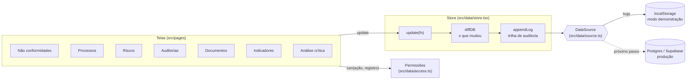

# Arquitetura do SGQ Rotalume

Este documento explica como o sistema está organizado e o caminho para levá-lo do modo demonstração (dados no navegador) a um produto com banco de dados, login e várias empresas.

## Visão geral



### Camadas

| Camada | Arquivo | Responsabilidade |
|---|---|---|
| Tipos | `src/data/types.ts` | Modelo de dados: processos, NCs, auditorias, documentos, indicadores, riscos, análises críticas e trilha |
| Regras | `src/data/utils.ts` | Bloqueios do PDCA, vencimentos, metas, nível de risco |
| Permissões | `src/data/access.ts` | O que cada perfil pode criar, editar e excluir |
| Alterações | `src/data/changes.ts` | Compara o banco antes e depois, descreve os campos e registra a trilha |
| Análise crítica | `src/data/review.ts` | Monta as entradas da cláusula 9.3.2 a partir dos módulos |
| Fonte de dados | `src/data/source.ts` | Onde os dados ficam. Hoje: navegador. Interface pronta para backend |
| Store | `src/data/store.tsx` | Único ponto de escrita: aplica, registra, persiste |

### Por que toda escrita passa pelo store

As telas nunca gravam direto no armazenamento. Elas chamam `update(fn)`, e o store:

1. aplica a mudança numa cópia do banco;
2. calcula com `diffDB` quais registros foram criados, alterados ou excluídos;
3. acrescenta essas mudanças à trilha de auditoria, com usuário, data e valor anterior;
4. entrega o novo estado e a lista de mudanças para `source.persist`.

Isso garante que **nenhuma alteração escapa da trilha** e que trocar o armazenamento não exige mexer nas telas.

## Caminho para produção

### 1. Banco de dados

Cada coleção vira uma tabela. Os campos aninhados (ações 5W2H, checklist, revisões, resultados mensais) podem ficar em colunas `jsonb` no início e virar tabelas filhas quando houver necessidade de consulta.

```sql
create table companies (id uuid primary key default gen_random_uuid(), name text not null);

create table members (
  company_id uuid references companies on delete cascade,
  user_id uuid references auth.users on delete cascade,
  role text not null check (role in ('gestor', 'dono', 'auditor', 'leitor')),
  name text not null,
  primary key (company_id, user_id)
);

create table ncs (
  id text not null,
  company_id uuid not null references companies on delete cascade,
  code text not null,
  data jsonb not null,            -- o objeto NonConformity
  owner text generated always as (data->>'owner') stored,
  process_id text generated always as (data->>'processId') stored,
  updated_at timestamptz default now(),
  primary key (company_id, id)
);
-- mesmo formato para processes, audits, docs, kpis, risks, reviews

create table audit_log (
  id bigint generated always as identity primary key,
  company_id uuid not null references companies,
  at timestamptz not null default now(),
  user_id uuid not null references auth.users,
  entity text not null,
  entity_id text not null,
  action text not null,
  fields jsonb not null
);
-- a trilha só aceita inserção: sem update nem delete para ninguém
```

### 2. Permissões no banco (Row Level Security)

As regras de `access.ts` viram políticas. Exemplo para não conformidades:

```sql
alter table ncs enable row level security;

create policy "membros leem a própria empresa" on ncs for select
  using (company_id in (select company_id from members where user_id = auth.uid()));

create policy "gestor ou responsável edita" on ncs for update
  using (exists (
    select 1 from members m where m.company_id = ncs.company_id and m.user_id = auth.uid()
      and (m.role = 'gestor' or m.name = ncs.owner)
  ));

create policy "só gestor exclui" on ncs for delete
  using (exists (select 1 from members m where m.company_id = ncs.company_id and m.user_id = auth.uid() and m.role = 'gestor'));
```

Assim a regra vale mesmo se alguém chamar a API sem passar pela interface. A interface continua usando `can()` só para esconder botões.

### 3. Nova fonte de dados

Uma implementação de `DataSource` que grava apenas o que mudou:

```ts
// src/data/supabaseSource.ts (esboço)
import { createClient } from '@supabase/supabase-js';
const sb = createClient(import.meta.env.VITE_SUPABASE_URL, import.meta.env.VITE_SUPABASE_ANON_KEY);

export const supabaseSource: DataSource = {
  name: 'Banco de dados da empresa',
  load: () => null, // carregamento assíncrono: buscar as tabelas no login e preencher o store
  async persist(_next, changes) {
    for (const c of changes) {
      if (c.action === 'delete') await sb.from(c.entity).delete().eq('id', c.id);
      else await sb.from(c.entity).upsert({ id: c.id, company_id: companyId, code: c.after!.code, data: c.after });
    }
  },
  clear: () => {},
};
```

A trilha passa a ser gravada pelo próprio banco (trigger em cada tabela), e não pelo navegador, para não depender do cliente.

### 4. O que mais entra num produto

- Login com e-mail e convite de usuários por empresa.
- Notificações por e-mail de prazos (NC, ação, documento, reavaliação de risco), com uma função agendada no servidor.
- Anexos (fotos, PDFs) no armazenamento de arquivos, ligados ao registro.
- Fluxo de aprovação de documentos (elaborar → revisar → aprovar) com registro de quem aprovou.
- Módulos de fornecedores (IQF), treinamentos e competências, e calibração de instrumentos.
- Adequação à LGPD: termos de uso, exportação e exclusão de dados pessoais a pedido.

O modo demonstração continua existindo ao lado do login, para quem quiser conhecer o sistema sem cadastro.

## Testes

- `npm test` roda os testes de regra de negócio (Vitest): bloqueios do PDCA, faixas da matriz de risco, detecção de alterações, junção da trilha, permissões por perfil, migração de versão e entradas da análise crítica.
- O GitHub Actions (`.github/workflows/ci.yml`) roda lint, testes e build a cada envio.
